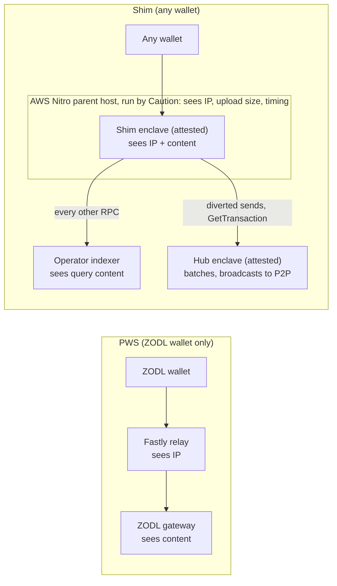

# Shim vs Private Wallet Servers

ZODL's Private Wallet Servers (PWS) send every wallet request through a Fastly OHTTP relay to a ZODL gateway. The zero-indexer shim is an attested enclave in front of an operator's indexer. It diverts privacy-sensitive sends to a batching hub. Each design wins on different axes.

Checked 2026-11-10 against the zero-indexer docs, ZODL's Android SDK 8.0.0, live DNS and TLS, and Fastly's product docs.

## Who sees what

The wallet's TLS session ends inside the shim enclave, which acts as the wallet's lightwalletd. The parent host only relays encrypted bytes. The diagram shows the managed Caution deployment we recommend. In BYOC, which we advise against, the operator runs the parent host and sees what it sees.

## Side by side

| | Shim | PWS |
|---|---|---|
| Requests covered | Diverted sends and `GetTransaction`. Every other RPC reaches the operator. | **All requests: sync, queries, sends.** |
| Trust anchor | **Attestation: reproducible build, all three PCRs checkable by anyone.** | Contract: Fastly and ZODL stay separate and keep logs apart. |
| Against an active operator | Caution's parent host sees the IP, upload size and timing. The operator sees forwarded queries, their timing, and the `SendTransaction` missing among them. With the wallet's transparent addresses, at today's batch size of one, that links the wallet to the published transaction ([README](README.md), Not protected). Larger batches give a conditional anonymity set. We advise against BYOC, which also hands the operator the parent host. | Linking needs Fastly and ZODL to collude. |
| Wallet support | **Any wallet, zero changes.** | ZODL wallet only. Relay and gateway URLs are fixed at build time. |
| Manual server | **Protected wherever the operator runs the shim with hub diversion on (phase 2).** A forward-only shim (phase 1) only classifies and logs ([OPERATORS.md](shim/deploy/caution/OPERATORS.md)). | Falls back to plain gRPC. |
| Where content concentrates | **Spread across operators.** | One gateway sees every PWS user's queries. |
| Broadcast | **Hub batches and publishes. P2P sees the hub as origin.** Batch size today: 1. | Sent from ZODL's backend. No batching. |
| Key handling | Key born in the enclave. Certificates appear in CT logs. | Signed key config over DNS, rotated every 6 hours. |

Bold marks the stronger side of each row.

## Our edges

- The shim works for every wallet today. This includes ZODL users who pick a community server that runs a diverting shim.
- Anyone can check our guarantee. PWS users trust a contract.
- The hub batches broadcasts and hides the origin from P2P. PWS sends each transaction alone from ZODL's backend.

## Gaps to close

- The transparent-address RPCs reach the operator: `GetTaddressTransactions`, `GetTaddressTxids`, `GetAddressUtxos`, `GetAddressUtxosStream`, `GetTaddressBalance` and `GetTaddressBalanceStream`. From them the operator recovers a diverted send's txid and value. Route them to the zero-indexer. [ENDPOINTS.md](shim/ENDPOINTS.md) lists the full INTERCEPT set, which also covers the mempool RPCs and `GetLatestTreeState`.
- The wallet's upload is unpadded, so its size matches it to a batch member.
- A batch of one gives no anonymity set.

## How the PWS facts were checked

- SDK `zcash-android-backend 8.0.0` (published 2026-11-09) holds the relay `zodl-ohttp-relay-prod.fastly-edge.com/relay` and the gateway `ohttp-gateway.zodl.com`. Its `isOhttpGateway` check sends any other server over direct gRPC.
- `fastly-edge.com` is Fastly's own domain. Fastly runs its nameservers, and Certainly (Fastly's CA) issues the relay's certificate. Only provisioned subdomains resolve. The relay accepts POST only.
- Fastly's [OHTTP Relay docs](https://docs.fastly.com/products/oblivious-http-relay) give customers no control-panel or API access to the service and forbid PII logging. The docs are silent on how long Fastly keeps client IPs.
- The gateway hostname has no public DNS record. The key config is a signed TXT record at `mainnet.ohttp-keys.zodl.com`, valid for 6 hours.
