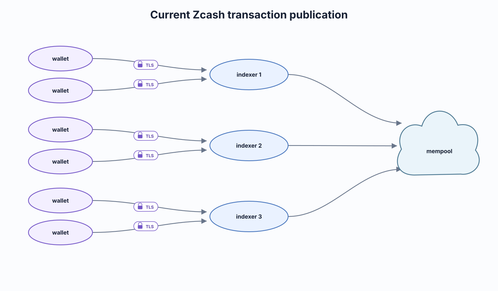

# zero-indexer

[](https://github.com/ShieldedLabs/zero-indexer/actions/workflows/zeronym-guards.yml)
[](https://github.com/ShieldedLabs/zero-indexer/actions/workflows/zeronym-hub-reproduce.yml)
[](https://github.com/ShieldedLabs/zero-indexer/actions/workflows/zeronym-shim-reproduce.yml)
[](https://github.com/ShieldedLabs/zero-indexer/releases/latest)
[](#license)

An attested front end for Zcash light-wallet indexers.

When a light wallet sends a transaction, the indexer it talks to sees the wallet's IP address and the time. If that transaction moves funds between pools, the move is public on chain, so the operator can tie an IP address to an amount. `zero-indexer` puts a small router, the shim, in front of an existing indexer, inside an attested enclave. The shim takes Orchard transactions off the normal path and hands them to a hub, which publishes them in batches. As long as someone else runs the hub's indexers, the operator's indexer never sees them.


Today each batch holds a single transaction, so a wallet can't hide in a crowd yet. Read [Security](#security) before you rely on it.

If you run an indexer, start with the [operator runbook](./shim/deploy/caution/OPERATORS.md). Wallet developers should start with [Usage](#usage), and auditors with the [audit steps](./AUDITING.md).

`zero-indexer` is built by [Shielded Labs](https://shieldedlabs.net). The long-term goal is a private indexer for all wallet traffic, over Nym and inside an attested enclave, with private information retrieval (PIR) added later.

The repository builds two binaries, `zero-indexer-shim` and `zero-indexer-hub`. The project's internal name, zeronym, still appears in some workflow and crate names.

## Table of Contents

- [Security](#security)
- [Background](#background)
- [Install](#install)
- [Usage](#usage)
- [How it works](#how-it-works)
- [Status](#status)
- [Maintainers](#maintainers)
- [Thanks](#thanks)
- [Contributing](#contributing)
- [License](#license)

## Security

To report a vulnerability, follow the [security policy](./SECURITY.md).

With a hub configured, this much is protected:

- The peer-to-peer network sees the hub as the sender.
- Diverted transactions and the lookups for them skip the operator's indexer, as long as someone else runs the hub's indexers.
- The wallet's TLS key stays inside the enclave, so the parent host carries a diverted transaction as ciphertext. Caution runs the parent host on a managed app, and the operator runs it only in bring-your-own-cloud.

Even with a hub, this isn't protected:

- With one transaction per batch, the parent host and the wallet's ISP can link a wallet's IP address to its transaction, and the operator can link the wallet itself to it.
- The shim forwards transparent-address queries, so the operator learns the wallet's transparent addresses, and from them a diverted transaction's txid and its value.
- Wallets only check the public certificate authorities. The operator controls the DNS, so it could get a second certificate and read traffic from the wallet's path. Certificate Transparency logs publish that certificate, but among the routine ones each enclave restart orders.
- On a clearnet hub hop, anyone on that path with a certificate for the hub's name can read diverted transactions.
- The size and timing of each submission are visible on the way in. Anyone can spot a flush on chain, or ask a hub whether a txid is in its queue.
- AWS and Caution are trusted with the hardware and the platform.

The [threat model](./THREAT-MODEL.md) has the full list, with the exact conditions for each claim.

### How we verify it

- When hub or shim code changes, CI builds that binary twice from cold on a native x86_64 runner and checks both builds against the hash in this repository ([hub](./.github/workflows/zeronym-hub-reproduce.yml), [shim](./.github/workflows/zeronym-shim-reproduce.yml)). The recipe was first reproduced on a different machine. These two checks aren't required for a merge.
- To check a live endpoint without trusting whoever runs it, follow the [audit steps](./AUDITING.md). They reproduce the binary, verify the enclave's attestation, and compare the deployed tree with this repository. Two of the steps still trust Caution's Caddy server.
- The protocol has a [Quint model](./spec/quint/README.md). Each pull request runs a bounded random simulation of it. TLC also checks every reachable state of a scaled-down hub model, in the four configurations we claim schedule guarantees for.
- [cargo vet](https://mozilla.github.io/cargo-vet/) runs on each pull request, so a new dependency can't merge without an audit or a recorded exemption. Most are exempted today: 712 of the hub's 846 crates and 759 of the shim's 901.
- Taylor Hornby's review raised 42 high and medium findings. By the last count in [`REVIEW_STATUS.md`](./REVIEW_STATUS.md), 27 are fixed or mitigated, and 23 of those have checks that run in CI.
- Daily jobs read the latest mainnet and testnet blocks through the shim's parser, and run the hub's live-chain tests against two mainnet indexers.

## Background

A light wallet reads the chain through an indexer. Trial decryption happens on the wallet, so the indexer never learns which notes belong to it. But the indexer still sees the wallet's IP address, when it sends each request, and which addresses it asks about.



A transaction that moves funds from one pool to another shows that move on chain. So the operator can join two facts: this IP sent something at time T, and a transaction moving this much appeared at time T. Shielded cryptography can't help, because the leak is in the network connection. The chain is permanent, so the link can be made later too.

The worst case is the move from Orchard to Ironwood. Every Orchard holder has to make it in a fixed window, which puts a huge number of revealing transactions close together. Zooko called it the worst privacy-loss event in Zcash history. This project starts with these transactions because they aren't urgent and can wait for a batch. In this README, a *migration* means any transaction with Orchard actions.

Wallets still speak the light-wallet protocol from [ZIP 307](https://zips.z.cash/zip-0307), and the shim sits in front of an unmodified [lightwalletd](https://github.com/zcash/lightwalletd) or [Zaino](https://github.com/zingolabs/zaino). The enclaves are [AWS Nitro Enclaves](https://aws.amazon.com/ec2/nitro/nitro-enclaves/) run through [Caution](https://caution.co). The shim-to-hub hop can go over the [Nym](https://nymtech.net) mixnet. The adversaries come from Taylor Hornby's [wallet app threat model](https://zcash.readthedocs.io/en/latest/rtd_pages/wallet_threat_model.html).

## Install

Indexer operators run `zero-indexer`. The shim sits behind your existing public URL, in front of your existing indexer, which doesn't change. Wallets don't need to change either.

The full steps are in the [operator runbook](./shim/deploy/caution/OPERATORS.md). A third-party operator has followed it end to end. To set it up, create an empty public git repository for the app source, then assemble the shim's enclave app:

```bash
git clone https://github.com/ShieldedLabs/zero-indexer && cd zero-indexer
sh shim/deploy/caution/assemble-caution.sh \
  --name        <enclave-name> \
  --backend     <indexer-ipv4>:<port> \
  --backend-tls <name-on-indexer-cert> \
  --tls-domain  <wallet-facing-domain> \
  --app-source  <public-git-url> \
  --hub         <hub-ip>:443 \
  --hub-tls     <hub-domain>
```

Without `--hub`, or `--hub-nym` for the Nym transport, the shim forwards everything and gives no privacy. Shielded Labs gives you the hub's address.

### Dependencies

- A [Caution](https://caution.co) account, which needs an access code, and the `caution` CLI. The runbook says how to get both.
- An empty public git repository, for the app source that auditors rebuild.
- Your indexer, lightwalletd or Zaino, at a literal `IPv4:port` over TLS.
- A DNS name that you control, for wallets.

## Usage

Nothing changes for wallet users. Wallet developers must pick anchors and expiry heights that line up within a migration epoch, as [ZIP 318](https://zips.z.cash/zip-0318) describes. A transaction that uses the newest anchor is dated by it, and that date makes it easy to find in a batch. Also plan for these:

- The hub can hold a diverted transaction for up to about 8 minutes.
- Over Nym, the shim reports success before the hub confirms it has the transaction, so a migration can fail silently. Anyone can cause that by filling a hub queue lane (see [hub failure modes](./hub/deploy/caution/OPERATORS.md#known-failure-modes)). Over clearnet, the shim waits for the hub and passes a refusal back to the wallet.
- If a migration doesn't confirm, the wallet has to send it again, because its notes stay locked until expiry, 30 to 60 days later. Resending is safe. The hub drops duplicates, and answers `rejected` for a transaction that's already mined.

Operators run the shim and can also run a hub. With a hub configured, migrations, transparent-only spends, `GetTransaction` lookups and any `SendTransaction` the shim can't read all leave the operator's view. Everything else passes through as before. Without a hub, the shim forwards every transaction it can read and gives no privacy.

Auditors can check an endpoint without trusting its operator, with the [five audit steps](./AUDITING.md). Steps 2 and 4 still trust Caution's Caddy server.

To try a shim and a hub locally on the public Nym mixnet, with no deploy, build both with the mixnet driver and run the smoke test. You need outbound internet access, `python3` and a `curl` with HTTP/2. On mainnet the hub warms up for at least five minutes before the checks run.

```bash
(cd shim && cargo build --release --features mixnet-driver)
(cd hub && cargo build --release --features mixnet-driver)
sh smoke-local.sh
```

### CLI

The shim and the hub take their options as CLI flags or environment variables. The runbooks list the main ones in their config references, for the [shim](./shim/deploy/caution/OPERATORS.md#config-reference) and the [hub](./hub/deploy/caution/OPERATORS.md#config-reference). `--help` lists every flag with its environment variable:

```bash
cd shim && cargo run --locked -- --help
cd ../hub && cargo run --locked -- --help
```

The smoke test passes most of these settings as environment variables. As flags, with the binary built above and a Nym hub, they look like this. `--require-diversion true` makes the shim refuse to start unless a hub is configured, and auditor step 4 checks for it:

```bash
shim/target/release/zero-indexer-shim \
  --listen            127.0.0.1:9068 \
  --backend           <indexer-ipv4>:<port> \
  --backend-tls       <name-on-indexer-cert> \
  --hub-nym           <hub-nym-address> \
  --require-diversion true
```

## How it works

In the diagram at the top, the green boxes are attested enclaves. They're the only places where a migration exists in the clear. Normal traffic takes the grey dashed path from a shim to its indexer, as it does today. Diverted transactions go to the hub instead, over the Nym mixnet or clearnet. Each shim runs its Nym client in-process, so wallets never touch the mixnet. Transactions from different shims leave the mixnet as one stream, and the hub can't tell which shim sent which.

The shim, `zero-indexer-shim`, decides where a `SendTransaction` goes by the pools it touches. It ignores amounts and destinations:

```text
divert(tx) := is_orchard_touching(tx) || is_transparent_only_spend(tx)
```

Because Orchard hasn't taken in new funds since NU6.3, any Orchard spend comes from notes held since before then, and the spend itself is the identifying event. The shim decides before it contacts the indexer. With a hub configured, it diverts or refuses a transaction it can't parse, and never forwards it. It keeps no state about migrations.

The hub, `zero-indexer-hub`, queues what every shim sends. Every 20 blocks it publishes the queue, shuffled and in parallel. Only block height starts a flush, because a count trigger would let an attacker flood the queue to isolate one target. The hub accepts a migration only if it will still be valid after the next flush. It refuses one that doesn't fit its lane's share of the flush budget, so each batch fits in one block.

## Status

These parts are deployed: classification and diversion, the hub's queue and flush, `GetTransaction` at the hub, attested Nitro enclaves with TLS inside (since 2026-08-01, with the first third-party operator on 2026-08-10), and the Nym transport on the public mixnet (since 2026-08-14).

Replication across hubs is partly built. The shim offers each migration to every hub it knows and never fails over, because picking a hub by health would let an attacker take one down during a retry and isolate that migration. The shim reports success after the first hand-off, so under mixnet backpressure only some hubs may hold the migration. Holding a migration across requests is still to be built.

Some parts are designed but have no code yet: a shim-side check of the hub's attestation (STEVE or RA-TLS), encryption to the hub's key on the clearnet hop, the keymaker quorum and consortium governance, and confirmation tracking.

On 2026-08-11, a real migration from Orchard to Ironwood crossed the whole stack on mainnet, and the operator's indexer never saw it. That run used the clearnet hop and a batch of one, which means it tested only the mechanics and content privacy. Batching anonymity is still untested, and nobody has seen a migration cross Nym in production yet.

## Maintainers

- [Mark Henderson](https://github.com/aphelionz)
- [Shoaib Ahmed](https://github.com/hu55a1n1)
- [Aayush Giri](https://github.com/Giri-Aayush)

All three work at [Shielded Labs](https://shieldedlabs.net).

## Thanks

[Diagrams](https://github.com/zookoatshieldedlabs/zero-indexer-diagrams) by Zooko, with the Nym hop added. Thanks to Caution and to Nym.

## Contributing

Ask questions and report bugs in [GitHub issues](https://github.com/ShieldedLabs/zero-indexer/issues). Do not report a vulnerability in an issue. Follow the [security policy](./SECURITY.md).

Pull requests are welcome. The [contributing guide](./CONTRIBUTING.md) gives the checks to run and the requirements for a pull request.

The contribution we want most is a review of the architecture: start with [Security](#security). The [open questions](./OPEN-QUESTIONS.md) with Caution have their own file, and releases follow the [release playbook](./RELEASING.md).

## License

`MIT OR Apache-2.0` © 2026 [Shielded Labs](https://shieldedlabs.net)

Licensed under either the [Apache License, Version 2.0](./LICENSE-APACHE) or the [MIT license](./LICENSE-MIT), at your option. The vendored crates in `vendor/` are under their own licenses.

Unless you explicitly state otherwise, any contribution intentionally submitted for inclusion in the work by you, as defined in the Apache-2.0 license, shall be dual licensed as above, without any additional terms or conditions.
