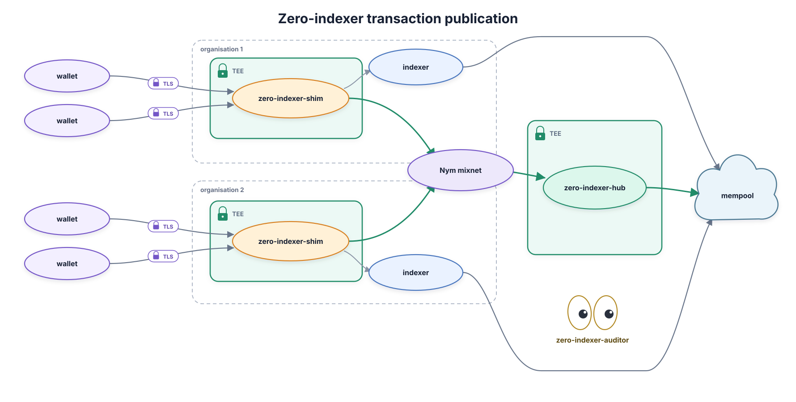

# zero-indexer

[](https://github.com/ShieldedLabs/zero-indexer/actions/workflows/zeronym-guards.yml)
[](https://github.com/ShieldedLabs/zero-indexer/actions/workflows/zeronym-hub-reproduce.yml)
[](https://github.com/ShieldedLabs/zero-indexer/actions/workflows/zeronym-shim-reproduce.yml)
[](https://github.com/ShieldedLabs/zero-indexer/releases/latest)
[](#license)

An attested front end for Zcash light-wallet indexers.

When a light wallet sends a transaction, the indexer it talks to sees the wallet's IP address and the time. If funds cross between pools in that transaction, the amount is public on chain. So the operator can tie an IP address to an amount. With `zero-indexer`, a small router called the shim runs in front of an existing indexer, inside an attested enclave. The shim takes Orchard transactions off the normal path and hands them to a hub. The hub publishes them in batches. The operator's indexer never receives them on the wallet's connection.



Today each batch holds one transaction. Against the operator, the parent host and the wallet's ISP, the anonymity set is one. Read [Security](#security) before you rely on it.

If you run an indexer, start with the [operator runbook](./shim/deploy/caution/OPERATORS.md). Wallet developers should start with [Usage](#usage), and auditors with the [audit steps](./AUDITING.md).

`zero-indexer` is built by [Shielded Labs](https://shieldedlabs.net). The long-term goal is a private indexer for all wallet traffic, over Nym and inside an attested enclave. Private information retrieval (PIR) is planned after that.

The two binaries are `zero-indexer-shim` and `zero-indexer-hub`. The project's internal name, zeronym, is still in some workflow and crate names.

## Table of Contents

- [Security](#security)
- [Background](#background)
- [Install](#install)
- [Usage](#usage)
- [How it works](#how-it-works)
- [Status](#status)
- [Maintainers](#maintainers)
- [Thanks](#thanks)
- [Contributing](#contributing)
- [License](#license)

## Security

To report a vulnerability, follow the [security policy](./SECURITY.md).

With a hub configured, this much is protected:

- The peer-to-peer network sees the hub's node as the origin.
- Diverted transactions and the lookups for them skip the operator's indexer, as long as someone else runs the hub's indexers.
- The wallet's TLS key stays inside the enclave, so the parent host carries a diverted transaction as ciphertext. Caution runs the parent host on a managed app. The operator runs it only in bring-your-own-cloud.

Even with a hub, these stay exposed:

- At batch size one, the parent host and the wallet's ISP can link a wallet's IP address to its transaction. The operator can link the wallet itself to it.
- The shim forwards transparent-address queries, so the operator learns the wallet's transparent addresses. From them, the operator can recover a diverted transaction's txid and its value.
- Wallets only check the public certificate authorities. The operator controls the DNS zone, so it can get a second valid certificate. From a position on the wallet's path, it can then read the traffic. Certificate Transparency logs publish that certificate, among the routine ones ordered at each enclave restart.
- On a clearnet hub hop, anyone on that path with a certificate for the hub's name can read diverted transactions.
- The parent host and the wallet's ISP see the size and timing of each submission. Anyone can spot a flush on chain. Anyone can also ask a hub whether a txid is in its queue.
- AWS and Caution are trusted with the hardware and the platform.

The [threat model](./THREAT-MODEL.md) has the full list, with the exact conditions for each claim.

### How we verify it

- When hub or shim code changes, CI builds that binary twice from cold on a native x86_64 runner ([hub](./.github/workflows/zeronym-hub-reproduce.yml), [shim](./.github/workflows/zeronym-shim-reproduce.yml)). CI then compares both builds with the hash in this repository. The recipe was first reproduced on a different machine. A merge can proceed while these two checks are pending or red.
- An auditor can check a live endpoint while treating its operator as untrusted, with the [audit steps](./AUDITING.md). In those steps, the auditor reproduces the binary, verifies the enclave's attestation, and compares the deployed tree with this repository. The auditor also checks the published parameters and where the domain points. Caution's Caddy server is trusted in steps 2 and 4.
- The protocol has a [Quint model](./spec/quint/README.md). CI runs a bounded random simulation of it on each pull request. TLC also checks every reachable state of a scaled-down hub model, in the four configurations with a claimed schedule guarantee.
- [cargo vet](https://mozilla.github.io/cargo-vet/) runs on each pull request. A new dependency merges only with an audit or a recorded exemption. As of 2026-11-23, most dependencies are exempted: 712 of the hub's 846 crates and 759 of the shim's 901.
- Taylor Hornby reported 42 high and medium findings in a security review. In [`REVIEW_STATUS.md`](./REVIEW_STATUS.md), read on 2026-11-23, 27 are fixed or mitigated. Of those, 23 have checks that run in CI.
- CI runs two daily workflows. One reads the latest mainnet and testnet blocks through the shim's parser. The other runs the hub's live-chain tests against mainnet indexers.

## Background

A light wallet reads the chain through an indexer. Trial decryption happens on the wallet, so the wallet's notes stay private from the indexer. But the indexer still sees the wallet's IP address, the time of each request, and the addresses the wallet queries.


A move of funds from one pool to another is public on chain. So the operator can join two facts. First, something was sent from this IP at time T. Second, a transaction moving this much appeared on chain at time T. The leak is in the network connection, outside the reach of shielded cryptography. The chain is permanent, so the link can be made later too.

The worst case is the move from Orchard to Ironwood. Every Orchard holder has to make it in a fixed window. So a huge number of revealing transactions land close together. Zooko called it the worst privacy-loss event in Zcash history. We start with these transactions because they can wait for a batch. In this README, a *migration* is any transaction with Orchard actions.

Wallets still speak the light-wallet protocol from [ZIP 307](https://zips.z.cash/zip-0307). The shim sits in front of an unmodified [lightwalletd](https://github.com/zcash/lightwalletd) or [Zaino](https://github.com/zingolabs/zaino). The enclaves are [AWS Nitro Enclaves](https://aws.amazon.com/ec2/nitro/nitro-enclaves/) run through [Caution](https://caution.co). The shim-to-hub hop can go over the [Nym](https://nymtech.net) mixnet. The adversaries are the server-side and network-metadata adversaries in Taylor Hornby's [wallet app threat model](https://zcash.readthedocs.io/en/latest/rtd_pages/wallet_threat_model.html).

## Install

Indexer operators run `zero-indexer`. The shim sits behind your existing public URL, in front of your existing indexer, which stays as it is. Wallets keep working as before.

The full steps are in the [operator runbook](./shim/deploy/caution/OPERATORS.md). A third-party operator has followed it end to end. First, create an empty public git repository for the app source. Then assemble the shim's enclave app:

```bash
git clone https://github.com/ShieldedLabs/zero-indexer && cd zero-indexer
sh shim/deploy/caution/assemble-caution.sh \
  --name        <enclave-name> \
  --backend     <indexer-ipv4>:<port> \
  --backend-tls <name-on-indexer-cert> \
  --tls-domain  <wallet-facing-domain> \
  --app-source  <public-git-url> \
  --hub         <hub-ip>:443 \
  --hub-tls     <hub-domain>
```

The shim diverts transactions only when `--hub` or `--hub-nym` (the Nym transport) is set. Otherwise the shim forwards each `SendTransaction` it reads in full to the operator's indexer, unparseable ones included. Shielded Labs gives you the hub's address and domain.

With either flag, the assembler also sets `ZIS_REQUIRE_DIVERSION=true`, which is required by audit step 4.

### Dependencies

- A [Caution](https://caution.co) account, which needs an access code, and the `caution` CLI. Both are covered in the runbook.
- An empty public git repository, for the app source that auditors rebuild.
- Your indexer, lightwalletd or Zaino, at a literal `IPv4:port` over TLS.
- A DNS name that you control, for wallets.

## Usage

Wallet users keep using their wallets as before. Wallet developers must pick anchors and expiry heights that line up within a migration epoch, as described in [ZIP 318](https://zips.z.cash/zip-0318). A transaction with the newest anchor is dated by it. With that date, it is easy to find in a batch. Also plan for these:

- The hub can hold a diverted transaction for up to about 25 minutes.
- Over Nym, the shim reports success before the hub confirms it has the transaction. So a migration can fail silently. Anyone can cause that by filling a hub queue lane (see [hub failure modes](./hub/deploy/caution/OPERATORS.md#known-failure-modes)). Over clearnet, the shim waits for the hub and passes a refusal back to the wallet.
- If a migration fails to confirm, the wallet has to send it again. Otherwise its notes stay locked until expiry, 30 to 60 days later. Resending is safe. The hub drops duplicates. It answers `rejected` for a transaction that's already mined.

Operators run the shim and can also run a hub. With a hub configured, these skip the operator's indexer: migrations, transparent-only spends, `GetTransaction` lookups and any unparseable `SendTransaction`. That holds as long as someone else runs the hub's indexers. Everything else passes through as before.

Auditors start with the [five audit steps](./AUDITING.md).

To try a shim and a hub locally on the public Nym mixnet, build both with the mixnet driver. Then run the smoke test. You need outbound internet access, `python3` and a `curl` with HTTP/2. On mainnet the hub warms up for at least five minutes before the checks run.

```bash
(cd shim && cargo build --release --features mixnet-driver)
(cd hub && cargo build --release --features mixnet-driver)
sh smoke-local.sh
```

### CLI

The shim and the hub take their options as CLI flags or environment variables. The main ones are in the config references of the [shim runbook](./shim/deploy/caution/OPERATORS.md#config-reference) and the [hub runbook](./hub/deploy/caution/OPERATORS.md#config-reference). Run `--help` for every flag and its environment variable:

```bash
(cd shim && cargo run --locked -- --help)
(cd hub && cargo run --locked -- --help)
```

Run the shim binary built above with a Nym hub:

```bash
shim/target/release/zero-indexer-shim \
  --listen            127.0.0.1:9068 \
  --backend           <indexer-ipv4>:<port> \
  --backend-tls       <name-on-indexer-cert> \
  --hub-nym           <hub-nym-address> \
  --require-diversion true
```

With `--require-diversion true`, the shim starts only when `--hub` or `--hub-nym` is set. This setting is required by audit step 4.

## How it works

In the diagram at the top, the green boxes are attested enclaves. Before the hub publishes a batch, a migration is in the clear in the wallet and in these enclaves. Normal traffic takes the grey dashed path from a shim to its indexer, as it does today. Diverted transactions take the orange path to the hub instead, over the Nym mixnet or clearnet. Each shim runs its Nym client in-process, so the mixnet is invisible to wallets. Over Nym, transactions from different shims leave the mixnet as one stream. So the sending shim of each transaction is hidden from the hub. The hub can still group one shim's sends while that shim keeps its Nym identity. By default, that can be the shim's whole uptime.

The shim, `zero-indexer-shim`, decides where a `SendTransaction` goes by the pools it touches. It ignores amounts and destinations:

```text
divert(tx) := is_orchard_touching(tx) || is_transparent_only_spend(tx)
```

Since NU6.3, Orchard has been closed to new funds. So any value spent from Orchard today was already in Orchard before then. The spend itself is the identifying event. The shim decides before it contacts the indexer. With a hub configured, the shim diverts or refuses an unparseable transaction. So it forwards only transactions it can parse. The shim is stateless across migrations.

The hub, `zero-indexer-hub`, queues diverted transactions from every shim. Every 60 blocks (about 25 minutes) it publishes them, shuffled and in parallel. The hub flushes by block height, or by a clock estimate of it while the tip is stale. It also flushes at shutdown. With a count trigger, an attacker could flood the queue to isolate one target. The hub accepts a migration only if it will still be valid after the next flush. It refuses a migration that would exceed its lane's share of the flush budget. So each batch fits in one block.

## Status

These parts are deployed:

- Classification and diversion.
- The hub's queue and flush.
- `GetTransaction` at the hub.
- Attested Nitro enclaves with TLS inside, since 2026-08-01. The first third-party operator joined on 2026-08-10.
- The Nym transport on the public mixnet, since 2026-08-14.

Replication across hubs is partly built. The shim offers each migration to every configured hub. If the shim picked hubs by health, an attacker could take one down mid-retry and isolate that migration. The shim reports success after the first hand-off, so under mixnet backpressure only some hubs may hold the migration. Holding a migration across requests is still to be built.

These parts are designed and still to be built:

- A shim-side check of the hub's attestation, with STEVE or RA-TLS.
- Encryption to the hub's key on the clearnet hop.
- The keymaker quorum and consortium governance.
- Confirmation tracking.

On 2026-08-11, a real migration from Orchard to Ironwood went through the whole stack on mainnet. The operator's indexer never received it on the wallet's connection. The run was over the clearnet hop, with a batch of one. So only the mechanics and content privacy were tested. Batching anonymity is still to be tested. A migration over Nym in production is still to be observed.

## Maintainers

- [Mark Henderson](https://github.com/aphelionz)
- [Shoaib Ahmed](https://github.com/hu55a1n1)
- [Aayush Giri](https://github.com/Giri-Aayush)

All three work at [Shielded Labs](https://shieldedlabs.net).

## Thanks

[Diagrams](https://github.com/zookoatshieldedlabs/zero-indexer-diagrams) by Zooko. Thanks to Caution and to Nym.

## Contributing

Ask questions and report bugs in [GitHub issues](https://github.com/ShieldedLabs/zero-indexer/issues). Report a vulnerability through the [security policy](./SECURITY.md) instead.

Pull requests are welcome. The checks to run and the requirements for a pull request are in the [contributing guide](./CONTRIBUTING.md).

The contribution we want most is a review of the architecture: start with [Security](#security). The [open questions](./OPEN-QUESTIONS.md) with Caution are in their own file. The release steps are in the [release playbook](./RELEASING.md).

## License

`MIT OR Apache-2.0` © 2026 [Shielded Labs](https://shieldedlabs.net)

Licensed under either the [Apache License, Version 2.0](./LICENSE-APACHE) or the [MIT license](./LICENSE-MIT), at your option. The vendored crates in `vendor/` are under their own licenses.

Unless you explicitly state otherwise, any contribution intentionally submitted for inclusion in the work by you, as defined in the Apache-2.0 license, shall be dual licensed as above, without any additional terms or conditions.
